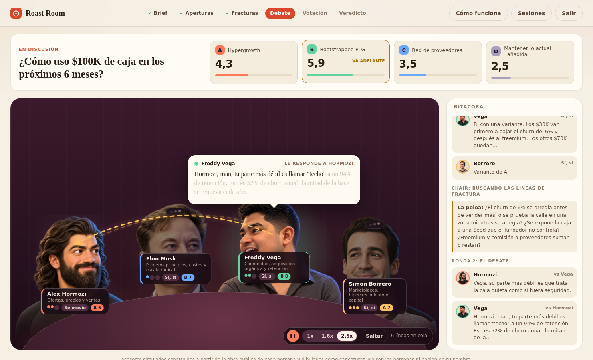

# Roast Room

Lleva una decisión de negocio difícil a un consejo de cuatro asesores simulados. Lo debaten en tres rondas dentro de Claude Code, y una sala web local los muestra como caricaturas alrededor de una mesa: se responden con flechas, votan con fichas y cierran con un veredicto que se baja en PDF.

| Asiento | Pilar | La pregunta que posee |
|---|---|---|
| Alex Hormozi | Ofertas, precios y ventas | ¿La gente va a pagar, cuánto, y cómo cerramos? |
| Elon Musk | Primeros principios, costos y escala radical | ¿Está limitado por la física y las matemáticas o por la sabiduría convencional? |
| Freddy Vega | Comunidad, adquisición orgánica y retención | ¿Crea valor real, construye comunidad leal y escala de forma orgánica? |
| Simón Borrero | Marketplaces, hipercrecimiento y capital | ¿Cómo dominamos el mercado, construimos densidad y ejecutamos a velocidad extrema? |

## Qué necesitas

- [Claude Code](https://claude.com/claude-code).
- [Node.js](https://nodejs.org) 20 o superior. No hay nada que instalar con npm: el proyecto no tiene dependencias.

## Cómo correr una sesión

0. Clona el repo y entra: `git clone https://github.com/AceleraTalent/roast-room.git && cd roast-room`.
1. Abre la sala: `npm start` y entra a http://localhost:4730. Déjala abierta (es opcional, pero es el espectáculo).
2. Abre Claude Code dentro de esta carpeta con `claude`. Debe ser una sesión nueva, porque los asientos se registran al iniciar.
3. Escribe `/roast-room` y tu decisión: opciones (mínimo A y B), números reales, qué significa el éxito y hacia dónde te inclinas.
4. Responde las preguntas del Chair si le falta algo.
5. Mira las tres rondas en la sala. Al final, "Descargar PDF" abre la impresión del navegador con la hoja del veredicto: elige "Guardar como PDF".

Para preguntarle algo a un solo asiento: `/roast-room consulta musk ¿cómo bajo el costo de entrega?`. Para usar solo algunos asientos: `/roast-room --asientos hormozi,vega <decisión>`.

## La sala

Es una vista local, sin API ni claves, que lee `sessions/` y reproduce el consejo:

- Retratos que mueven la boca al hablar según las vocales de cada palabra, parpadean y se inclinan hacia quien responden.
- Globo de diálogo anclado a quien habla, con las palabras que se iluminan una a una.
- Flecha de réplica en la Ronda 2, panel de fracturas (quién está de cada lado) tras la Ronda 1 y fichas de voto en la Ronda 3.
- Marcador por opción que se actualiza ronda a ronda, con el cálculo ponderado a la vista (pasa el cursor sobre una opción).
- Clic en un asiento o en una línea de la bitácora para leer su tarjeta completa, con cada cita marcada como verificada o no contra su brain.
- Pausa (barra espaciadora), velocidades 1x, 1,6x y 2,5x, saltar (flecha derecha), sesiones guardadas y enlace directo (`#sesion=<id>`).
- Si Claude Code todavía escribe la sesión, la sala la sigue en vivo y muestra qué pesa cada asiento mientras espera.
- Veredicto a pantalla completa con puntajes, razones, condiciones, riesgos con señales tempranas, pasos, disidencia y marcador por asiento.

`npm run probar` revisa que cada sesión guardada se pueda reproducir.

## Qué poner en tu pregunta

- La decisión y las opciones concretas.
- Ingresos, margen, caja o runway, retención o churn, CAC, equipo: lo que aplique.
- Qué significa el éxito y para cuándo.
- Hacia dónde te inclinas y por qué. El consejo pone a prueba tu inclinación, no la repite.

## Cómo está armado

| Capa | Dónde | Qué hace |
|---|---|---|
| Brains | `.claude/skills/roast-room/brains/<experto>/` | Base de conocimiento de cada asiento, con citas textuales y su fuente |
| Subagentes | `.claude/agents/council-*.md` | Lente, voz y reglas de cada asiento |
| Chair | `.claude/skills/roast-room/SKILL.md` | Valida el brief, corre las tres rondas, fuerza al abogado del diablo y calcula el veredicto |
| Sesiones y reporte | `sessions/<id>/` y `scripts/generate_report.mjs` | `brief.json`, un JSON por ronda y un `index.html` autosuficiente |
| Sala web | `sala/` | Servidor local y vista interactiva (`servidor.mjs`, `lib/`, `publico/`) |

Regenerar el reporte de una sesión: `npm run report -- sessions/<id>`. Una sesión completa son 12 ejecuciones de subagentes (4 asientos por 3 rondas).

## Aviso

Los asientos son simulaciones construidas a partir de la obra pública de cada persona. No son las personas, no hablan por ellas y ninguna está afiliada a este proyecto. Un asiento solo cita a la persona textualmente cuando la frase está en su brain con su fuente, y el generador del reporte verifica cada cita atribuida. Los retratos son caricaturas generadas con IA; los de Musk, Vega y Borrero se hicieron a partir de fotos públicas como referencia de parecido (las fotos no se incluyen en el repositorio). Cada brain lista sus fuentes en `sources.md`.

El código se publica bajo licencia MIT (ver `LICENSE`). La licencia cubre el código y la estructura del proyecto, no los textos de terceros que cada brain cita con su fuente.
